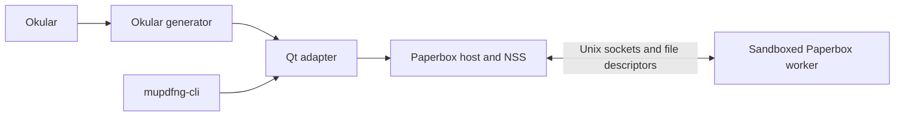

# Architecture

Okular and `mupdfng-cli` both use the Qt adapter in `src/plugin/`. The adapter
links statically to the Paperbox host and NSS libraries. It starts the separate
`paperbox-worker` executable, which Paperbox builds from the revision pinned by
the submodule.

## Okular and CLI integration

`src/generator/` owns the Okular interface, UI, configuration, and conversions
between Okular and Paperbox model values. It restores the document and settings
after the worker restarts. Under Strict sandbox enforcement, it withholds
documents until the worker reports a fully hardened sandbox.

`src/plugin/` adapts Paperbox events to queued Qt signals and keeps each
rendered frame alive for the lifetime of its `QImage`. It also handles OCR
scheduling, NSS database selection and certificate management, and XFDF
conversion. The CLI uses the same adapter and builds without KDE.

`src/shared/` holds application-facing helpers. Callers use Paperbox directly
for operations with native types. The Qt adapter handles events, lifecycle
transitions, and operations that need Qt types.

## Paperbox and the worker

Paperbox owns worker supervision, private IPC, input and output descriptors,
rendered frames, signing and verification, and persistent caches. The worker
owns document parsing, rendering, editing, export, and OCR for PDF, EPUB, MOBI,
DRM-free AZW3 and single-container KFX, and XPS/OpenXPS.

The Qt adapter uses the established `mupdfng` cache root. Paperbox can read the
previous Qt OCR cache format and builds fresh accelerators or generated outlines
when a cache entry is incompatible.

See the [Paperbox native architecture](thirdparty/paperbox/src/README.md) for
the host and worker internals. The [installation guide](INSTALL.md) describes
the local build and optional Bubblewrap launcher.

## Tests

This project tests the plugin, GUI integration, and CLI. The link checks verify
the worker stays free of Qt and KDE dependencies and that the plugin and CLI use
static Paperbox libraries. Paperbox maintains the native and worker suites in
[its test tree](thirdparty/paperbox/test/README.md).
