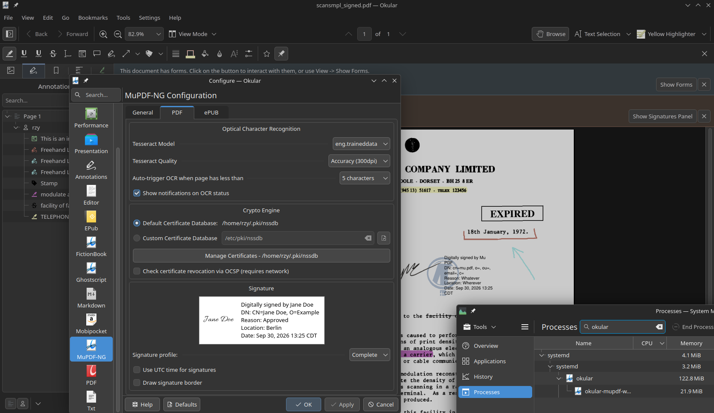

# [okular-mupdf-ng](https://l4rzy.github.io/okular-mupdf-ng)

  
  
  
   
  
  
   
  
  

A MuPDF-based **secure** and fast backend for Okular. Document rendering is moved to an isolated and hardened worker process. This reduces the impact of MuPDF vulnerabilities while keeping Okular's desktop integration seamless. Supports PDF, ePUB, and MOBI formats.

---

## Installation

See [INSTALL.md](INSTALL.md) for community repos, prebuilt packages, build requirements, and
instructions for building from source.

---

## Motivation
Okular is an amazing piece of software: it's packed with good features; it's also extendable with a flexible plugin system. However, there are caveats that hold it back. This plugin solves the following issues with the current Okular's backends, with the hope of making it more complete:
 - PDF is a complex format, it should not be parsed and rendered in Okular's memory space unconfined. See Chromium's [Rule of Two.](https://chromium.googlesource.com/chromium/src/+/master/docs/security/rule-of-2.md)
 - PDF backend with Poppler is rich in features, but sluggish on big PDFs. This is a known weakness of Poppler.
 - Rendering quality of the default ePUB & MOBI backends are terrible, plus rendering speed is also painstakingly slow even on a high-end CPU.

---

## Architecture

The document engine runs in an isolated worker process, where potentially unsafe
documents are parsed and rendered. See [ARCHITECTURE.md](ARCHITECTURE.md) for
component responsibilities, IPC, shared rendering buffers, sandboxing, caches,
and the source-tree layout.

---

## Feature Comparison

| Feature Category | Capabilities | okular-mupdf-ng | Okular official backends |
|---|---|:---:|:---:|
| **Safety & Isolation** | Sandboxed out-of-process worker (Landlock, Seccomp, namespaces, resource limits) | ✓ | ✗ (in-process execution) |
| **Smart Document Theming** | Default, Twilight, Dusk, and Dark viewing themes for all supported formats | ✓ | ✗ (Accessibility color modes) |
| **OCR** | Built-in Tesseract page OCR engine | ✓ | ✗ |
| **ePUB/MOBI customisation** | Custom CSS, Page size, Font size, Font family | ✓ | ✗ (Font size only) |
| **Certificate Manager** | NSS certificate manager; manage trust and generate RSA and ECDSA P-256 signing certificates | ✓ | ✗ (Cert listing only) |
| **Link Preview** | Preview internal link destinations on hover | ✓ | ✗ |
| **Annotation export** | Export PDF annotations to XFDF | ✓ | ✗ |
| **Flattened PDF export** | Bake annotations and form fields into PDF page content | ✓ | ✗ |
| **PDF Heuristic Outline** | Outline generation for PDFs that don't have embedded outline | ✓ | ✗ |
| **ePUB/MOBI export** | Export ePUB/MOBI to PDF, preserving links and TOC | ✓ (via MuPDF rendering) | ✗ (document print) |
| **Signature Profiles** | PDF Signature profiles and customisations | ✓ | ✗ |
| **Formats** | PDF, ePUB, MOBI | ✓ | ✓ |
| **PDF Forms** | AcroForm text inputs, checkboxes, radio buttons, choices, and push buttons | ✓ (AcroForm; XFA detected only) | ✓ (AcroForm; XFA detected only) |
| **PDF form JavaScript** | Calculations and button/field-event actions | ✓ (MuPDF/MuJS executes in the sandboxed worker; experimental, opt-in) | ✓ (Poppler passes scripts to Okular, which executes them in QJSEngine) |
| **Annotations** | Text, highlight, line, shape, ink, stamp, caret | ✓ | ✓ (plus sound, movie & file-attachment annotations) |
| **Document Tools** | Text search, outline/TOC, links, fonts, metadata, embedded files | ✓ | ✓ |
| **Printing & Exporting** | Print & Export | ✓ | ✓ |
| **PDF layers** | Toggle optional content in the Layers sidebar | ✓ | ✓ |

## Limitations

- MuPDF's ePUB & MOBI support are incomplete. ePUB 3.0 and modern MOBI are not fully
  supported, so some documents may render incorrectly.
- The NSS cryptographic code has not been fully audited.
- Sandbox is Linux only and its availability depends on Linux kernel and system support. Default to Strict Enforcement.
- Worker restart can not recover unsaved forms.
- Twilight, Dusk, and Dark prefer Okular's per-page [placeholder color API](https://invent.kde.org/graphics/okular/-/merge_requests/1527) when available.
  Older Okular versions use shared placeholder pixmaps and incomplete loading images. Extreme zoom or
  uncovered tile regions can still show default white placeholder with this fallback.

See the [feature maturity matrix](MATURITY.md) for feature-specific maturity and
automated test coverage.

## Changelog

See [CHANGELOG.md](CHANGELOG.md) for release highlights, fixes, and other changes.

## Contributing

See [CONTRIBUTING.md](CONTRIBUTING.md) for contribution and testing guidelines.
See [SECURITY.md](SECURITY.md) for the security contact.

## Credits

This project learned from amazing projects below

- [Okular Poppler Backend](https://invent.kde.org/graphics/okular/-/tree/master/generators/poppler) - Okular integration
- [SumatraPDF](https://github.com/sumatrapdfreader/sumatrapdf) - MuPDF API usage
- [Zathura](https://github.com/pwmt/zathura) - Seccomp rules
- [Sioyek](https://github.com/ahrm/sioyek) - MuPDF API usage

## License

Original project source code is licensed under the
[GNU General Public License v3.0 or later](COPYING) (`GPL-3.0-or-later`),
unless otherwise indicated.

Third-party components retain their respective licenses and copyright notices:

- **MuPDF**, including its [signature emblem](src/generator/config/signature_emblem.hpp):
  [GNU Affero General Public License v3.0 or later](thirdparty/mupdf-COPYING)
  (`AGPL-3.0-or-later`). The worker links against MuPDF; its license applies to
  the engine as well as the emblem. GPLv3 permits this combination, with the
  AGPL's network-interaction requirements applying to the combined work; see
  [GPLv3 section 13](https://www.gnu.org/licenses/gpl-3.0.html#section13).
- **Allura font**: [SIL Open Font License 1.1](thirdparty/allura/OFL.txt).
- **zpp::bits**: [MIT License](thirdparty/zpp/LICENSE).
- **cxxopts**: [MIT License](thirdparty/cxxopts/LICENSE).

Other dependencies and bundled resources, including fonts embedded by MuPDF,
retain their upstream licenses. This summary does not replace the full license
texts or component-specific notices.
